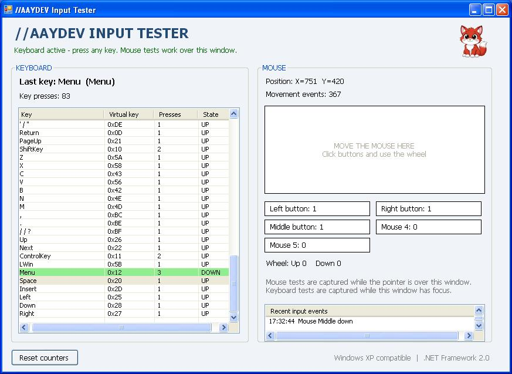

# Input Tester

A lightweight Windows Forms utility for testing keyboard and mouse input. This project was created as a companion diagnostic tool for **[Hecate](https://github.com/aaydev/hecate)**, AAYDEV's USB-to-PS/2 keyboard and mouse converter firmware for the Raspberry Pi Pico (RP2040).

## Purpose

Hecate allows modern USB keyboards and mice to be used with vintage computers and systems that accept PS/2 input devices. AAYDEV Input Tester helps check the input devices and verify the behavior of the keyboard and mouse signals received by a Windows test system when evaluating the Hecate converter.

The utility is an input-event tester; it does not communicate with the RP2040 directly and is not a PS/2 protocol analyzer. It displays the events that Windows delivers to the application.

## Features

### Keyboard
- Detects key-down and key-up events while the application window is active.
- Displays the key name and virtual-key code.
- Counts key presses, including repeated key-down events.
- Shows the latest key state (`DOWN` / `UP`).

### Mouse
- Displays pointer screen coordinates and counts movement events.
- Tests left, right, middle, fourth (`XButton1`), and fifth (`XButton2`) buttons.
- Counts mouse-wheel movement in both directions.
- Shows a short list of recent input events.

### Other
- Reset counters to clear the displayed statistics.
- AAYDEV logo is embedded in the executable as a manifest resource; no separate image file is needed to run the application.

## Requirements

- Windows XP SP2/SP3 or later.
- .NET Framework 2.0 runtime.
- x86 build (32-bit).

## Build

The solution is configured for **Visual Studio 2019** and targets **.NET Framework 2.0**.

1. Open `InputTester.sln` in Visual Studio 2019.
2. Select the `Release` configuration and `x86` platform.
3. Choose **Build → Rebuild Solution**.
4. The executable is produced in `InputTester\\bin\\Release\\InputTester.exe`.

The source image `InputTester/logo.png` is included as an embedded resource during compilation. It must remain in the source project, but it does not need to be copied alongside the built executable.

## Use

1. Launch `InputTester.exe`.
2. Click the application window and press keys to test the keyboard.
3. Move the mouse over the application window. Use the white mouse test area to test movement, buttons, and the wheel.
4. Click **Reset counters** to clear the results.

## Limitations

- This is a window-based tester, not a global input hook.
- Keyboard events are captured while the application window is active.
- Mouse events are captured while the pointer is over the application window.
- Secure Windows shortcuts such as `Ctrl+Alt+Del` are handled by Windows and cannot be captured by a regular Windows Forms application.

## Related project

- **Hecate — USB to PS/2 Keyboard and Mouse Converter for RP2040:** https://github.com/aaydev/hecate

## License

No separate license is specified for this utility in the supplied project files. Refer to the Hecate repository for the firmware project's license; do not assume that it automatically applies to this companion application.
